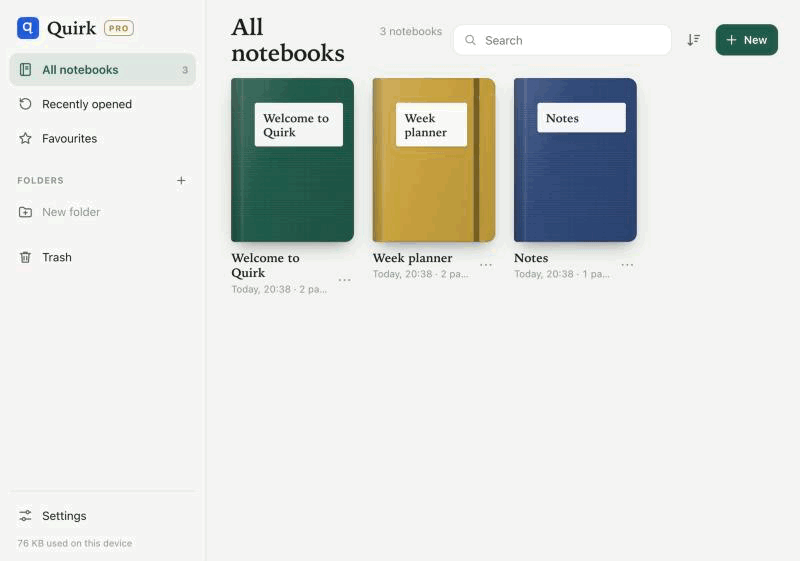
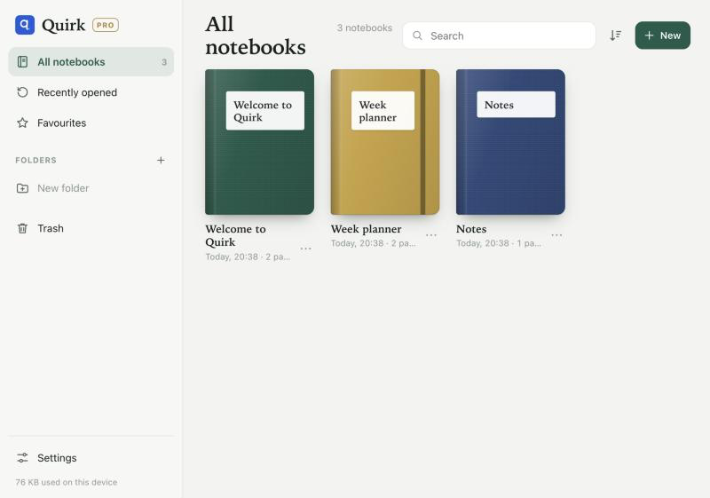
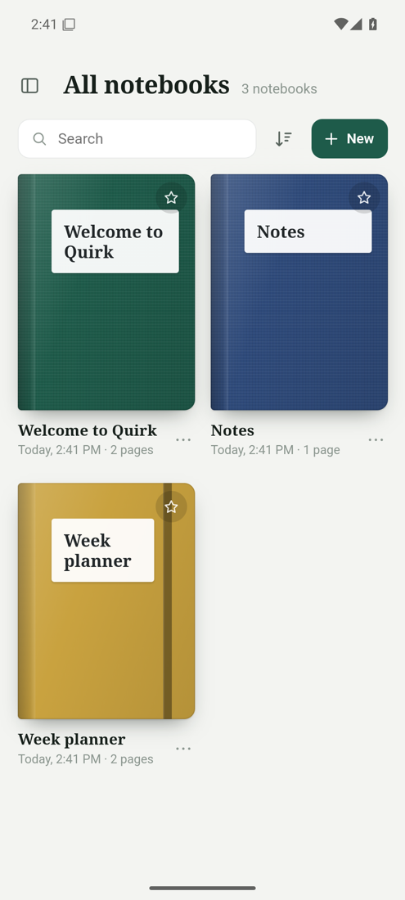

<p align="center"></p>

<h1 align="center">Quirk Notes</h1>

<p align="center"><strong>A free handwriting note-taking app for iPad and Android.</strong></p>

<p align="center">
  <a href="https://github.com/warriorbiswas-tech/Quirk-notes/releases/latest"></a>
  <a href="https://github.com/warriorbiswas-tech/Quirk-notes/releases"></a>
  
</p>

Quirk Notes lets you handwrite with a stylus, mark up PDFs and keep everything in tidy digital notebooks. Its AI turns your notes into summaries, flashcards, quizzes and mind maps, using your own free NVIDIA key or a model that runs on your device. It costs nothing, with no subscription, no account and no ads.

<p align="center">
  <a href="https://github.com/warriorbiswas-tech/Quirk-notes/releases/latest/download/Quirk-Notes.apk"><strong>Download for Android</strong></a> ·
  <a href="https://github.com/warriorbiswas-tech/Quirk-notes/releases/latest/download/Quirk-Notes.ipa"><strong>Download for iPad</strong></a> ·
  <a href="https://warriorbiswas-tech.github.io/Quirk-notes/app/"><strong>Try it in your browser</strong></a> ·
  <a href="https://quirk-notes.vercel.app/"><strong>Website</strong></a>
</p>

<p align="center"><a href="https://quirk-notes.vercel.app/">Watch the 20-second video</a></p>

<p align="center"></p>

## Quickstart

**In a browser, right now:** [open the web version](https://warriorbiswas-tech.github.io/Quirk-notes/app/).

**On Android** (64-bit, Android 8 or later): [download the APK](https://github.com/warriorbiswas-tech/Quirk-notes/releases/latest/download/Quirk-Notes.apk) on your device, open it and allow the install.

**On iPad** (iPadOS 17 or later): [download the IPA](https://github.com/warriorbiswas-tech/Quirk-notes/releases/latest/download/Quirk-Notes.ipa) on a Windows PC or Mac and install it with [Sideloadly](https://sideloadly.io) or [AltStore](https://altstore.io). It is unsigned, so with a free Apple ID it has to be reinstalled every 7 days.

**With Docker**, then open http://localhost:8080:

```bash
docker run -p 8080:80 ghcr.io/warriorbiswas-tech/quirk-notes
```

The [guide](https://quirk-notes.vercel.app/guide.html) covers installing, setting up AI and backups.

## Why Quirk Notes

- **Free, for everything.** Looking for a free alternative to note apps like GoodNotes or Notability? Nothing here is locked behind a subscription.
- **Ink that feels right.** Fountain pen, ballpoint, brush and pencil, with pressure, tapering and palm rejection.
- **PDFs you can write on.** Annotate textbooks and worksheets, search their text and export them again.
- **AI that studies with you.** Chat with your notes, and get summaries, flashcards, quizzes and mind maps.
- **Your key, or no key.** Bring a free NVIDIA key for large online models, or download a model that runs with no internet.
- **Your notes stay yours.** They live on your device, and nothing goes to NVIDIA unless you add a key.

| | iPad | Android | Browser |
| --- | --- | --- | --- |
| Handwriting and stylus | Yes | Yes | Yes |
| PDF annotation | Yes | Yes | Yes |
| AI study tools | Yes | Yes | No |
| On-device AI (one 1.1 GB download) | Yes | Yes | No |
| Recording with live transcript | Yes | Not yet | No |
| Sync | iCloud Drive | Not yet | No |

<p align="center">
  
  
</p>

## Sister app: Margin

[Margin](https://github.com/warriorbiswas-tech/margin-app) is made by the same developer for the same job: free handwritten notes, PDF markup and AI study tools, with no account and no subscription. It is written natively for iPad and Android, and its AI can run entirely on your device. [See Margin](https://margin-notes-app.vercel.app).

## Web version

The rest of this page is about the installable web version, in this folder, which the Android app is built from. It needs no App Store, Mac or Apple ID, and your notes stay on your device.

**Open it:** https://warriorbiswas-tech.github.io/Quirk-notes/app/

## Install on iPad (A16 or any iPad)

1. Open the link above in **Safari** on the iPad. Other browsers can't install apps on iPadOS.
2. Tap the **Share** button (the square with an arrow), then **Add to Home Screen**, then **Add**.
3. Open **Quirk** from the Home Screen. It runs full screen like a regular app and works offline.

Use the Home Screen icon from then on. A Home Screen app keeps its own storage, separate from Safari, so Safari's automatic clean-up of unused website data doesn't remove your notes. Deleting the app from the Home Screen does delete them, so make a backup first.

## Features

**Writing**
- Fountain pen, ballpoint, brush pen and textured pencil, with pressure and tapering
- Pressure from Apple Pencil (1st generation). Apple Pencil (USB-C) has no pressure sensor, so line width follows writing speed instead
- Palm rejection: once a Pencil is used, fingers scroll and zoom while the Pencil writes
- Highlighter that sits under the ink, with an optional straight-line mode
- Eraser: whole-stroke or precise, with a "highlighter only" option and auto switch-back
- Hold at the end of a stroke to snap it into a perfect line, circle, ellipse, triangle, rectangle or polygon, then keep moving to resize it. Snapping strength is adjustable, and there's also a dedicated Shapes tool
- Lasso: select ink, text, images and stickers; move, resize, rotate, recolour, copy, cut, duplicate, delete, bring to front
- Text boxes with five fonts, sizes, colours, bold and alignment. With Apple Pencil you can handwrite inside a text box and iPadOS Scribble turns it into typed text
- Images from Photos, Camera or Files; stickers, labels, washi tape and emoji
- Laser pointer for presenting
- Two-finger tap to undo, three-finger tap to redo (up to 250 steps while a notebook is open)

**Paper and pages**
- Blank, ruled (three spacings), grids, dot grid, Cornell notes, checklist, music staff, isometric, plus daily, weekly and monthly planners
- Adjustable line spacing for ruled, grid and dot pages, applied to one page or the whole notebook
- Seven paper colours including dark papers, five page sizes, portrait or landscape
- Page navigator with thumbnails, drag-to-reorder, bookmarks, duplicate, insert and delete
- Pinch zoom up to 600% with crisp vector ink at every zoom level

**PDFs and export**
- Import PDFs and annotate them; their text becomes searchable
- Import photos as pages
- Export a notebook, a page range or one page as PDF, or a page as a PNG image

**Library**
- Notebook covers (twelve colours, seven styles), folders, favourites, recently opened, trash
- Search across titles, typed text and text inside imported PDFs
- Light and dark mode
- One-file backup (.zip) and restore, for keeping copies in Files or iCloud Drive

## Good to know

- **Storage.** Notes are saved on the iPad as you write. Make a backup from Settings › Storage & backup now and then.
- **Updates.** The app updates itself in the background; the new version loads the next time you open it.
- **Offline.** After the first launch everything works without a connection. The handwriting font (Caveat) needs one online launch to be cached.

## Developing

There is no build step. Serve the folder with any static file server and open it:

```bash
python3 -m http.server 8000
```

- `index.html` loads the scripts in `js/` in order. Every module attaches to a global `Q` namespace.
- `js/ink.js` holds the stroke engine (smoothing, pressure, outlines, erasing, shape recognition).
- `js/render.js` holds the tiled page renderer. `js/editor.js` and `js/editor-ui.js` hold the notebook editor.
- `sw.js` is the offline service worker. Bump `VERSION` in it when you change the list of app files.
- `vendor/pdfjs/` is pdf.js 3.11.174 (Apache-2.0), used for PDF import.
- `android/` wraps these same files in an Android app. Run `gradle assembleDebug` in that folder, with the Android SDK and Gradle 8.13 installed.
